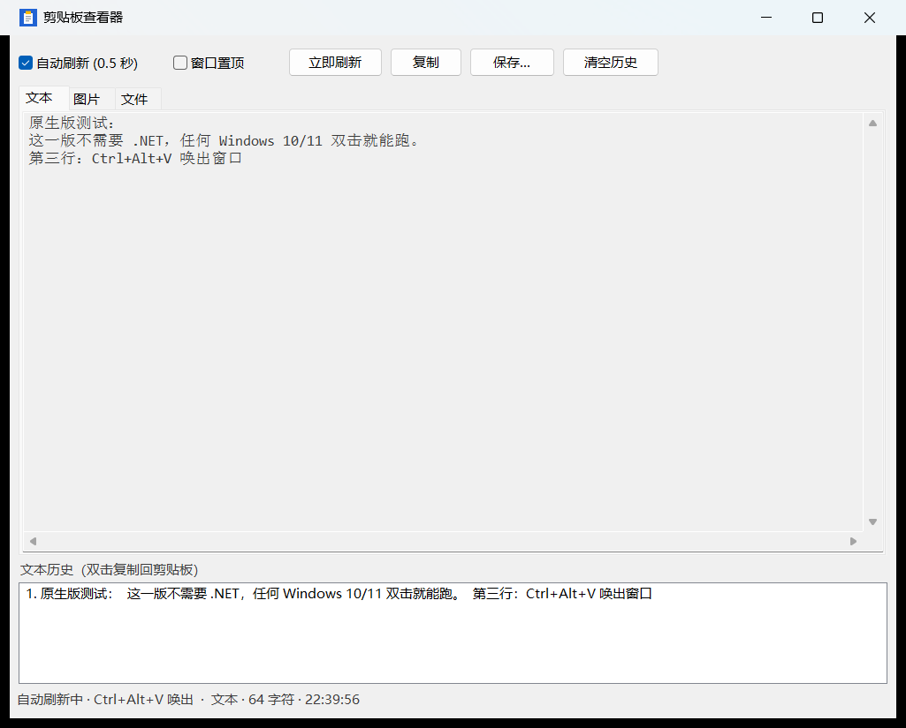
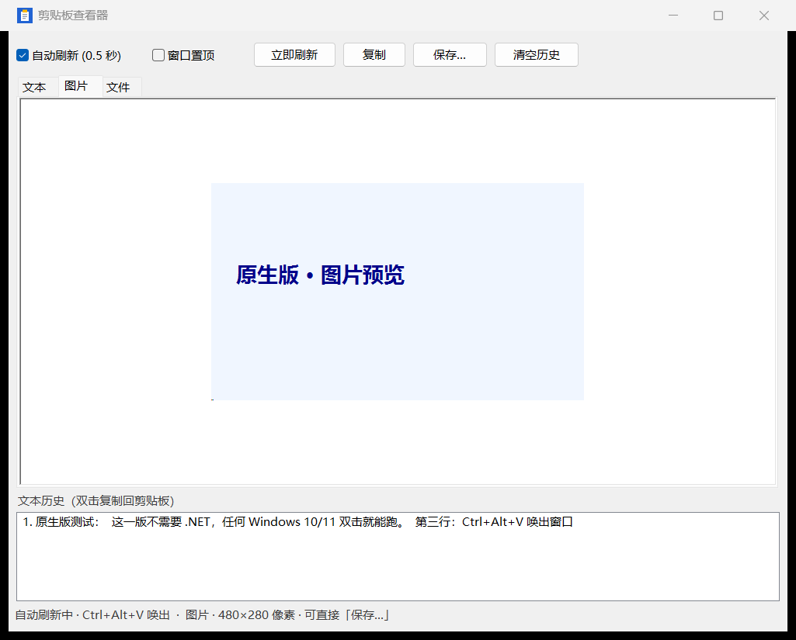
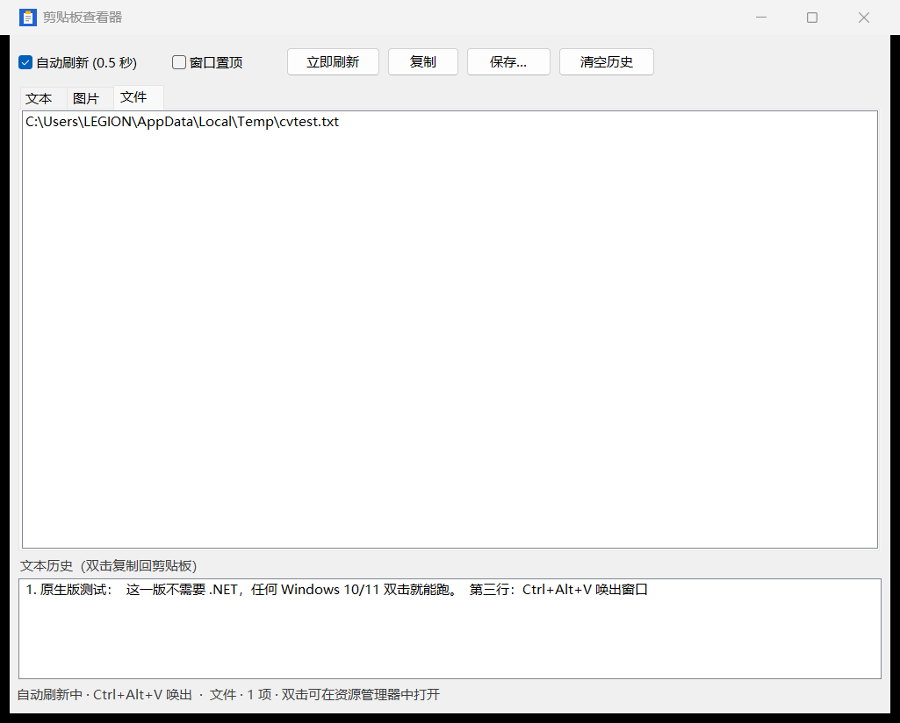

# Clipboard Viewer

A tiny (290 KB) single-file Windows utility that shows **what is currently in your clipboard** — text, images, and files — in real time. Text history, tray residency, and a global hotkey included. No installer, no .NET, no runtime dependencies.



## Features

- **Live refresh** — reads the clipboard every 0.5 s, so it always shows what you just copied
- **Three content types** — text (monospaced, selectable), images (scaled preview), and files (paths shown, double-click to open)
- **Text history** — the last 30 text entries, double-click any of them to copy it back
- **Save / copy** — text as `.txt`, images as `.bmp`, file lists as text
- **Always on top** — optional pin toggle
- **Tray residency** — the close button hides the window; quit from the tray menu
- **Global hotkey** — `Ctrl+Alt+V` brings the window up from anywhere, even when hidden
- **Single instance** — relaunching focuses the existing window instead of opening a second one

| Image view | File list view |
|:---:|:---:|
|  |  |

> The application interface is currently in Chinese. The executable itself is language-neutral and runs on any Windows locale.

## Download

Get **`ClipboardViewer-portable.zip`** from the [Releases](../../releases) page, unzip it anywhere, and run `ClipboardViewer.exe`. No installation required.

## Keyboard shortcuts

| Shortcut | Action |
|:---|:---|
| `Ctrl+Alt+V` | Show / focus the window (global) |
| `F5` | Refresh immediately |
| `Ctrl+S` | Save the current content |
| `Ctrl+L` | Clear the text history |

## Build from source

Requires [MinGW-w64](https://github.com/skeeto/w64devkit) (`w64devkit` is recommended — it is a portable archive, no installer):

```powershell
# add w64devkit\bin to PATH, then:
powershell -ExecutionPolicy Bypass -File build.ps1
```

The output is `dist\ClipboardViewer.exe`. The build uses static linking, so the resulting binary has no MSVC runtime dependency.

Or compile manually:

```bat
windres src\app.rc -O coff -o dist\app.res
g++ -O2 -s -mwindows -static -static-libgcc -static-libstdc++ ^
    -finput-charset=UTF-8 -fexec-charset=UTF-8 ^
    -o dist\ClipboardViewer.exe src\main.cpp dist\app.res ^
    -lgdi32 -lcomctl32 -lshell32 -lcomdlg32 -luser32 -lole32 -luuid
```

## Requirements

- Windows 10 or 11, 64-bit
- Nothing else

## Privacy

- Reads the clipboard **locally only** — no network access, no registry writes, no log files
- History is kept in memory and is gone when the program exits
- The clipboard is written to only when you press **Copy** or double-click a history entry

## Known issues

- Windows 11 files newly created tray icons into the `^` overflow area; drag the icon onto the taskbar to keep it visible
- Archives downloaded from a browser or chat app may be marked as blocked — right-click the `.zip`, open **Properties**, and unblock it before extracting

## License

[MIT](LICENSE)
